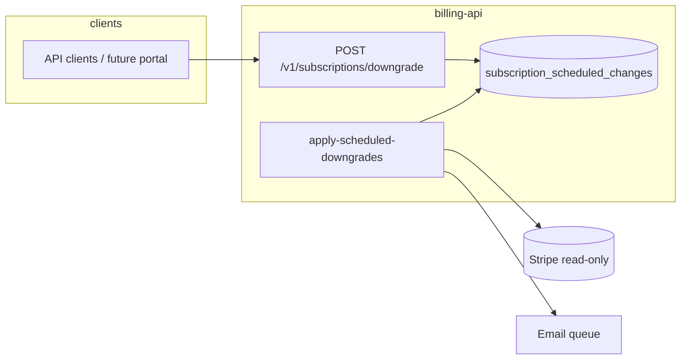
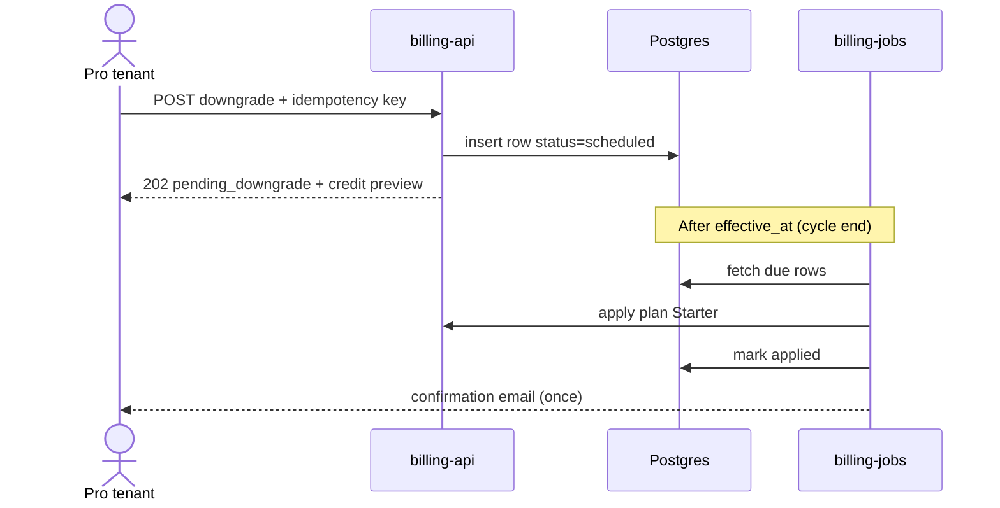

## Change Brief · PROJ-1234 · billing-api#842

**Status:** ready for human review
**Generated:** 2026-09-24T04:00:00.000Z · **Base:** `a1b2c3d` → `f4e5d6c`
**Source (`jira`):** [PROJ-1234](https://jira.example/browse/PROJ-1234) — Allow plan downgrade with proration

### One-liner

Pro users can downgrade to Starter via self-service; the system computes prorated credit and schedules the change at billing cycle end.

### Requirement (from source)

PROJ-1234 asks for self-service downgrade from Pro to Starter with prorated account credit applied at the end of the current billing cycle—not immediate plan swap or portal UI in this release.

### Integration (what was wired)

Public API accepts downgrade requests, persists scheduled changes in Postgres, and an hourly worker applies them at cycle boundary; Stripe is read-only for subscription identity until the job runs; confirmation email uses the existing queue.

| From | To | Protocol | Notes |
|------|-----|----------|-------|
| API clients | POST /v1/subscriptions/downgrade | HTTPS | Idempotency key required |
| billing-jobs worker | Postgres | SQL | effective_at index |
| billing-jobs worker | Stripe | API | Read subscription only |
| billing-jobs worker | Email queue | internal | Dedupe on retry |

*Architecture / wiring:*

*Happy path (verify in staging or review):*

### Agent considerations

| Question / concern | Resolution |
|--------------------|------------|
| Use Stripe Schedule vs internal scheduling? | Internal table owns effective date because ledger credit is not modeled in Stripe Schedule. |
| Ship portal UI in same MR as API? | No—frontend capacity; AC4 deferred to PROJ-1290 with flag off until portal ready. |
| Timezone for cycle end? | Document UTC in API; human checklist flags product confirmation. |

### Worth calling out

- Portal UI (AC4) is explicitly out of this MR—acceptable if PROJ-1290 is tracked.
- Feature flag `billing.downgrade_self_service` stays off in prod until portal ships.
- Migration must run before API deploy; worker can follow in a second deploy.

### How to judge if this is right

You do not need to read every file—confirm the story matches AC1–AC3 and that AC4 deferral is acceptable for your release.

**Correct signals**
- POST downgrade returns pending state and a credit amount tied to remaining cycle days—not an immediate Stripe plan change.
- Row in `subscription_scheduled_changes` with `effective_at` at cycle boundary; worker applies only after that timestamp.
- Repeat POST with same idempotency key does not double credit or create duplicate schedules.
- OpenAPI documents UTC for cycle end; tests cover proration edge at month boundary.

**Red flags — worth blocking or escalating**
- Stripe subscription price changes on API call instead of at job run.
- No migration or index on `effective_at` while worker scans full table.
- AC4 marked met without a tracked follow-up ticket.
- Feature flag default `true` in production config.

| Quick check | Pass if |
|-------------|---------|
| Call downgrade on staging Pro subscription mid-cycle | 202 + pending_downgrade; Stripe plan still Pro until job runs |
| Advance clock / seed row with effective_at in past; run job once | Plan becomes Starter; single confirmation email |
| Replay same idempotency key | Same response body; one schedule row |
| Scan MR traceability vs PROJ-1234 AC list | AC1–AC3 met with behavioral evidence; AC4 not_met with PROJ-1290 link |

### Requirements traceability

*Roll-up:* 4 requirement(s): 3 met, 1 not met.

| Requirement (AC / spec §) | Status | Evidence (no line numbers) |
|---------------------------|--------|------------------------------|
| AC1: Pro user can request downgrade | met | Endpoint validates current plan and creates scheduled row |
| AC2: Prorated credit | met | `ProrationService` uses remaining days in cycle |
| AC3: Effective at cycle end | met | Worker applies only when `effective_at <= now()` |
| AC4: Portal UI | not met | Explicitly out of scope; frontend ticket open |

### Behavior

**Before:** Full cancellation only; no partial plan downgrade.
**After:** Idempotent request by `subscription_id`; API returns interim `pending_downgrade` state.
**Feature flags / config:** `billing.downgrade_self_service` default `false` (ops enables per environment)

### Plan baseline (at task start)
- Downgrade Pro → Starter via self-service API
- Proration as internal account credit
- Effective at billing cycle end
- Portal UI out of this MR (PROJ-1290)

### Implementation chronicle

| # | Type | What happened | Decision / consequence |
|---|------|---------------|-------------------------|
| 1 | plan | Ticket and spec aligned on hourly job + scheduled table | Do not use Stripe Schedule as effective-date source of truth |
| 2 | discovery | Stripe Schedule does not model internal ledger credit | Table `subscription_scheduled_changes` owns effective date |
| 3 | decision | Feature flag off by default in prod | Ops enables `billing.downgrade_self_service` after portal ships |

### Deviations from plan

| Expected (ticket/plan) | What shipped instead | Reason | OK to merge? |
|------------------------|----------------------|--------|--------------|
| AC4 portal UI in same release | API + worker only; UI in PROJ-1290 | Frontend capacity not available this sprint | yes |

### Global view (capabilities / architecture)

| Capability or layer | Role in this MR | Notes |
|---------------------|-----------------|-------|
| Billing / public API | Downgrade endpoint + OpenAPI | Idempotency key documented |
| Jobs / billing-jobs | Applies scheduled downgrades | Email consumer dedupe |
| Data | Migration + effective_at index |  |

*Anchors:* `POST /v1/subscriptions/downgrade`, `migrations/20260326_subscription_scheduled_changes.sql`

### Scope

| Area | What changed (component level) |
|------|--------------------------------|
| API `subscriptions` | New `POST /v1/subscriptions/downgrade` with eligibility checks |
| Worker `billing-jobs` | Job `apply-scheduled-downgrades` runs hourly |
| DB | Table `subscription_scheduled_changes` + index on `effective_at` |
| Admin UI | No changes (public API documented in OpenAPI only) |

**In scope:** Pro → Starter downgrade; proration as account credit; confirmation email via existing queue.
**Out of scope (this MR):** upgrades; immediate cancellation; currency changes.
**Follow-up / explicit debt:** PROJ-1290 (show credit in UI).

### Surfaces and blast radius

- **Users / roles affected:** Pro plan tenants; Starter users unaffected.
- **Data:** Writes new table; reads `invoices` and `subscription_periods`.
- **Integrations:** Stripe read-only subscription id; no price change until job runs.
- **Deploy:** Run migration before API deploy; worker can follow in second deploy.

### Multi-repo

| Repo | MR | Role |
|------|-----|------|
| billing-api | #842 | API + migration + job |
| billing-portal | #119 | (pending) UI |

**Suggested merge order:** billing-api first with flag off; portal after.

### Human attention

1. Double downgrade request: confirm idempotency key is documented for API clients.
2. Cycle end timezone: confirm with product whether UTC or tenant timezone.
3. Duplicate emails on job retry: verify consumer dedupe.

### Deep dives (optional, max 3)

#### Why schedule in DB instead of Stripe Schedule

Stripe Schedules do not cover our internal credit model; effective date lives in our table for ledger reconciliation.

### Already covered by the quality agent

- API parameter injection: no findings.
- Parameterized SQL rules: OK.
- 2 minor style notes on tests (non-blocking).

**Open findings (agent):** 2.
**Review:** https://github.com/example/billing-api/pull/842#pullrequestreview-1

**Human does not need to re-check:** minor style already covered by repo rules.

### Human reviewer checklist (~2 min)

- [ ] Scope matches what I expected from the ticket
- [ ] Acceptable to ship AC4 in a follow-up ticket
- [ ] Flag off in prod until portal is ready
- [ ] Migration tested on staging with representative volume
- [ ] Agreed with product: effective date in UTC

---
*CBF v0.4 · generated by Change Brief · does not replace merge approval*